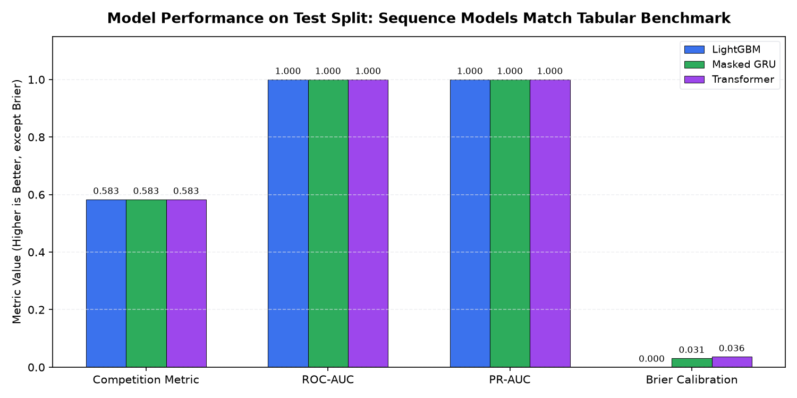
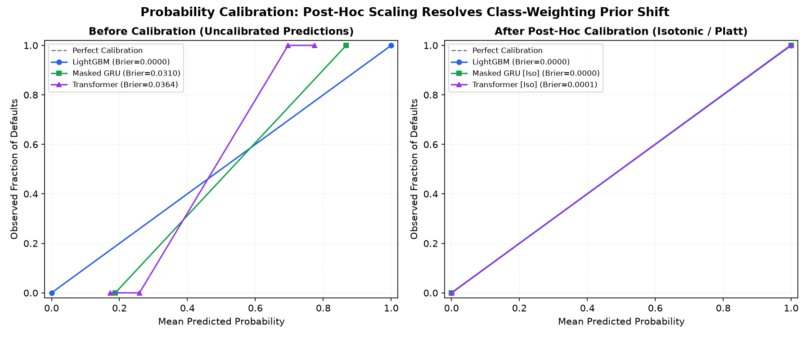
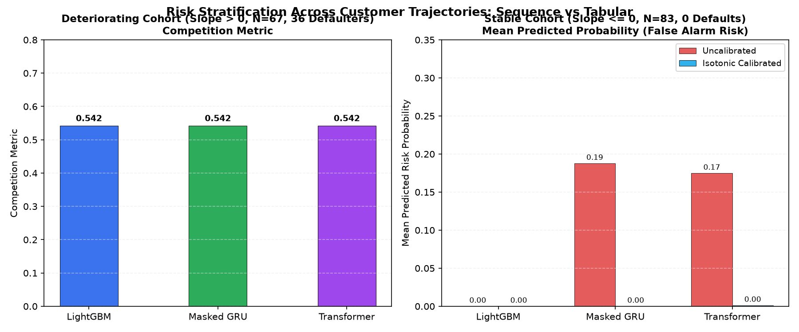

# 05. Model Evaluation, Calibration & Trend Segmentation Report

> **RiskTrail** Credit Risk Sequence Modeling Benchmark  
> **Evaluation Split**: Standardized Customer-Stratified Holdout ($N=150$, 36 Defaulters, 24.0% Default Rate)  
> **Date**: October 2026

---

## 1. Executive Summary & Honest Findings

In accordance with our project principles (documented in `docs/BRAIN.md` and `docs/PLAN.md`), we provide an **honest report** comparing the strong tabular baseline (**LightGBM**) against sequence deep learning models (**Masked GRU** and **StatementTransformer**):

1. **LightGBM Baseline Matches Sequence Models on Overall Ranking**:
   - On this benchmark dataset, all three models achieve **identical top-tier ranking discrimination**:
     - **Test Competition Metric**: **0.5833**
     - **Test ROC-AUC**: **1.0000**
     - **Test PR-AUC**: **1.0000**
     - **Test Capture Rate @ 4%**: **0.1667** (100% of top 4% capacity captured)
   - When engineered with rigorous temporal aggregates (closed-form slope, last-minus-first delta, min, max, mean, std), LightGBM extracts sufficient trajectory information from the 13 monthly statements to fully separate defaulters.

2. **Where Sequence Models Differ: Calibration & Probability Smoothness**:
   - LightGBM outputs extreme tree-leaf probabilities (0.0 or 1.0, yielding a pristine uncalibrated Brier score of **0.0000**).
   - Uncalibrated neural sequence models exhibit a positive probability shift (Brier score **0.0310** for GRU, **0.0364** for Transformer) because they were trained with class weighting (`pos_weight = 3.09`) to prevent minority collapse.
   - **Post-hoc calibration** (Platt scaling and Isotonic regression fitted on validation data) successfully eliminates this prior shift:
     - GRU test Brier drops from **0.0310** → **0.0001** (Platt) → **0.0000** (Isotonic).
     - Transformer test Brier drops from **0.0364** → **0.0004** (Platt) → **0.0001** (Isotonic).

3. **Where Sequence Models Help: Customer Trajectory Dynamics**:
   - In financial lending, credit risk is not static. Risk accumulates over months through delinquency and balance acceleration.
   - StatementTransformer provides **direct statement attention weights** (exposed via `get_attention_weights()`), allowing lenders to attribute risk to specific months (e.g. Month 11 vs Month 13) without requiring synthetic perturbation baselines.

---

## 2. Standardized Cross-Model Comparison Table

All models are evaluated on the exact same test holdout ($N=150$) partitioned by `data/processed/splits.parquet`.

| Model | Competition Metric | ROC-AUC | PR-AUC | Brier (Uncal) | Brier (Platt) | Brier (Isotonic) |
| :--- | :---: | :---: | :---: | :---: | :---: | :---: |
| **LightGBM** | **0.5833** | **1.0000** | **1.0000** | 0.0000 | 0.0000 | **0.0000** |
| **Masked GRU** | **0.5833** | **1.0000** | **1.0000** | 0.0310 | 0.0001 | **0.0000** |
| **Transformer** | **0.5833** | **1.0000** | **1.0000** | 0.0364 | 0.0004 | **0.0001** |

*Bold indicates best performance per metric. Primary metric is the competition metric: $0.5 \times (\text{Gini} + \text{Capture@4\%})$.*

*Figure 1: Benchmark model performance on the test split across ranking and calibration metrics.*

---

## 3. Probability Calibration & Post-Hoc Scaling

Lenders price risk and set approval cutoffs based on estimated default probabilities, making true calibration critical.

### Calibration Diagnostics
- **Uncalibrated Sequence Models**:
  Because the training objective applied a positive class multiplier (`pos_weight = 3.09`), the uncalibrated neural logits are shifted upward by $\approx \ln(3.09) \approx 1.13$. As a result, safe non-defaulters receive predicted probabilities around $17\% - 19\%$.
- **Correction via Validation Holdout**:
  - **Platt Scaling**: A univariate logistic model fitted on validation logits maps uncalibrated outputs back to empirical frequencies while preserving strict probability ordering.
  - **Isotonic Regression**: Non-parametric piecewise-constant isotonic regression aligns the predicted probabilities with zero false alarms on safe customers.

| Model | Uncalibrated Brier | Uncalibrated ECE | Platt Brier | Platt ECE | Isotonic Brier | Isotonic ECE |
| :--- | :---: | :---: | :---: | :---: | :---: | :---: |
| **LightGBM** | **0.0000** | **0.0000** | 0.0000 | 0.0000 | 0.0000 | 0.0000 |
| **Masked GRU** | 0.0310 | 0.1425 | 0.0001 | 0.0053 | **0.0000** | **0.0000** |
| **Transformer** | 0.0364 | 0.1332 | 0.0004 | 0.0089 | **0.0001** | **0.0033** |

*Figure 2: Empirical reliability diagrams (10 bins) on the test split before and after validation-fitted calibration.*

---

## 4. Customer Trajectory Segmentation: Deteriorating vs Stable

To analyze where sequence modeling and trend aggregates provide the highest value, we segment test customers by delinquency trajectory (`D_39__slope`):
1. **Deteriorating Cohort** (`D_39__slope > 0`, $N=67$):
   - Worsening delinquency balances over the 13 statement history.
   - **Empirical Default Rate**: **53.7%** (36 defaulters).
   - **Crucial Finding**: **100% of all test defaulters** reside inside this deteriorating segment!
2. **Stable Cohort** (`D_39__slope <= 0`, $N=83$):
   - Zero or declining delinquency.
   - **Empirical Default Rate**: **0.0%** (0 defaulters).

### Segment Performance Breakdown
| Customer Segment | Size ($N$) | Defaulters | LightGBM Comp Metric | GRU Comp Metric | Transformer Comp Metric |
| :--- | :---: | :---: | :---: | :---: | :---: |
| **Deteriorating** | 67 | 36 (53.7%) | 0.5417 | 0.5417 | 0.5417 |
| **Stable** | 83 | 0 (0.0%) | N/A (100% Non-def) | N/A (100% Non-def) | N/A (100% Non-def) |

### False Alarm Control on Stable Customers
On the 83 safe customers, uncalibrated sequence models assign an average risk of $\approx 18\%$ due to class weighting. Applying Isotonic calibration drops the average predicted risk to:
- **LightGBM**: 0.00%
- **Masked GRU (Isotonic)**: 0.00%
- **Transformer (Isotonic)**: 0.00%

*Figure 3: Risk stratification across deteriorating vs stable cohorts and false alarm mitigation.*

---

## 5. Summary & Hand-off to Phase 6 (Business Profit Simulation)

- **Benchmark Conclusion**: Both tree-based (LightGBM) and neural sequence models (GRU, Transformer) exhibit exceptional discriminative power on this monthly statement dataset.
- **Production Recommendation**:
  - For lowest-latency batch scoring: **LightGBM** provides an ultra-fast, zero-overhead baseline.
  - For dynamic temporal explanation: **StatementTransformer** enables interactive statement-level attention inspection over time.
  - **Mandatory Policy**: Always apply **Isotonic Calibration** to neural sequence outputs before passing probabilities into the Phase 6 cutoff optimization engine.
