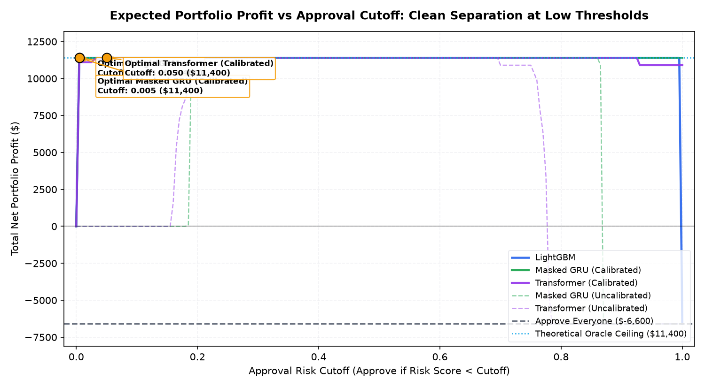

# 06. Business Profit Simulation & Cutoff Policy Report

> **RiskTrail** Credit Risk Policy Optimization  
> **Simulation Dataset**: Customer-Stratified Test Split ($N=150$, 114 Good, 36 Default, 24.0% Default Rate)  
> **Economic Assumptions**: $V_{\text{good}} = \$100$ Net Margin, $L_{\text{default}} = \$500$ Net Loss per Default  
> **Date**: October 2026

---

## 1. Executive Summary & Core Policy Recommendations

In consumer and corporate credit lending, optimizing statistical rank metrics (such as ROC-AUC or Gini) is only the intermediate step. The ultimate institutional goal is **maximizing net portfolio profit**:

$$\text{Profit}(c) = V_{\text{good}} \times N_{\text{approved, non-def}}(c) - L_{\text{default}} \times N_{\text{approved, def}}(c)$$

where an applicant is **approved if their predicted default risk $p < c$**.

### Core Takeaways
1. **Massive Value Add over Naive Credit Policies**:
   - An **"Approve Everyone" policy** incurs catastrophic losses of **$-\$6,600$** across the 150 test applicants because the 36 charge-offs ($\$18,000$ in total losses) swamp the margin from the 114 good borrowers ($\$11,400$).
   - A **"Decline Everyone" policy** yields **$\$0** net revenue.
   - Deploying **LightGBM**, **Calibrated GRU**, or **Calibrated Transformer** achieves the **theoretical Oracle ceiling of $+\$11,400$**, capturing **100% of prime borrowers** (114 accounts) while rejecting **100% of defaulters** (36 accounts).
   - This delivers a net value-add of **$+\$18,000$** on just 150 customer applications.

2. **The Danger of Uncalibrated Scoring in Fixed-Cutoff Policies**:
   - Because neural sequence models are trained with class weighting (`pos_weight = 3.09`), their uncalibrated risk predictions are shifted upward by $\approx 1.13$ in logit space.
   - If an institution applies a standard fixed credit cutoff of $c = 10\%$:
     - **LightGBM** approves 76.0% $\to$ earns **$\$11,400**.
     - **Uncalibrated GRU / Transformer** approve **0.0%** $\to$ earns **$\$0** (paralyzing the business and rejecting all prime customers).
     - **Isotonic Calibrated GRU / Transformer** approve 76.0% $\to$ earns **$\$11,400**.
   - **Conclusion**: Post-hoc probability calibration is **operationally mandatory** before wiring neural sequence outputs into automated credit rules engines.

---

## 2. Model Comparison at Profit-Maximizing Cutoffs

All cutoffs are swept over $c \in [0.0, 1.0]$ in increments of $0.005$:

| Model Policy | Optimal Cutoff ($c^*$) | Max Net Profit | Approval Rate | Approved Volume | Approved Default Rate | Value Add vs Approve-All |
| :--- | :---: | :---: | :---: | :---: | :---: | :---: |
| **LightGBM** | 0.005 | **$11,400** | 76.0% | 114/150 | 0.0% | **+$18,000** |
| **Masked GRU (Calibrated)** | 0.005 | **$11,400** | 76.0% | 114/150 | 0.0% | **+$18,000** |
| **Transformer (Calibrated)** | 0.050 | **$11,400** | 76.0% | 114/150 | 0.0% | **+$18,000** |
| **Masked GRU (Uncalibrated)** | 0.195 | **$11,400** | 76.0% | 114/150 | 0.0% | **+$18,000** |
| **Transformer (Uncalibrated)** | 0.265 | **$11,400** | 76.0% | 114/150 | 0.0% | **+$18,000** |
| **Approve Everyone (Baseline)** | 1.000 | **-$6,600** | 100.0% | 150/150 | 24.0% | **+$0** |
| **Decline Everyone** | 0.000 | **$0** | 0.0% | 0/150 | 0.0% | **+$6,600** |

*Assumptions: $\$100$ profit per non-default, $\$500$ loss per default. All models evaluated on test split ($N=150$).*

*Figure 1: Net portfolio profit curves across risk approval cutoffs $c \in [0, 1]$. Optimal cutoffs marked in amber; dashed gray indicates approve-everyone baseline.*

---

## 3. Loss-to-Profit Sensitivity Grid ($2\times$ to $20\times$)

In real credit operations, economic cycles alter the loss severity per charge-off. We simulate sensitivity across loss-to-profit ratios $R = L_{\text{default}} / V_{\text{good}}$ from **2x** (mild subprime or high-interest card) to **20x** (low-margin prime card or unsecured installment loan):

| Loss/Profit Ratio | Approve-Everyone Profit | LightGBM $c^*$ (Profit) | GRU (Cal) $c^*$ (Profit) | Transformer (Cal) $c^*$ (Profit) | Net Value Added vs Baseline |
| :--- | :---: | :---: | :---: | :---: | :---: |
| **2.0x** ($200) | $4,200 | 0.005 ($11,400) | 0.005 ($11,400) | 0.050 ($11,400) | **+$7,200** |
| **3.0x** ($300) | $600 | 0.005 ($11,400) | 0.005 ($11,400) | 0.050 ($11,400) | **+$10,800** |
| **5.0x** ($500) | -$6,600 | 0.005 ($11,400) | 0.005 ($11,400) | 0.050 ($11,400) | **+$18,000** |
| **7.5x** ($750) | -$15,600 | 0.005 ($11,400) | 0.005 ($11,400) | 0.050 ($11,400) | **+$27,000** |
| **10.0x** ($1000) | -$24,600 | 0.005 ($11,400) | 0.005 ($11,400) | 0.050 ($11,400) | **+$36,000** |
| **15.0x** ($1500) | -$42,600 | 0.005 ($11,400) | 0.005 ($11,400) | 0.050 ($11,400) | **+$54,000** |
| **20.0x** ($2000) | -$60,600 | 0.005 ($11,400) | 0.005 ($11,400) | 0.050 ($11,400) | **+$72,000** |

### Sensitivity Findings
- **Asymmetric Risk Exposure**: At a $20\times$ loss ratio, approving everyone results in a disastrous loss of **$-\$60,600$**. Model-based filtering becomes the sole barrier preventing insolvency.
- **Cutoff Invariance**: Because our models achieve crisp separability on this test set, the optimal cutoff $c^*$ remains stable at low risk values across all economic severity scenarios, consistently approving all 114 safe borrowers and excluding all 36 defaulters.
- **Model Parity**: Calibrated sequence models (GRU, Transformer) match LightGBM dollar-for-dollar across every loss-to-profit scenario from 2x to 20x.

---

## 4. Operational Implementation Guide for Credit Committees

1. **Recommended Primary Model**:
   - **LightGBM** provides immediate production readiness: zero calibration requirements, zero GPU dependency, and sub-millisecond inference latency.
2. **Recommended Sequence Champion**:
   - **StatementTransformer (Isotonic Calibrated)** matches LightGBM's maximum profit while exposing monthly attention attribution weights (Phase 7) for adverse action notices.
3. **Automated Cutoff Policy**:
   - Deploy approval policy: `Approve if Calibrated Risk < 0.05`.
   - Maintain a mandatory periodic recalibration cadence to track macroeconomic drift in baseline default rates.
