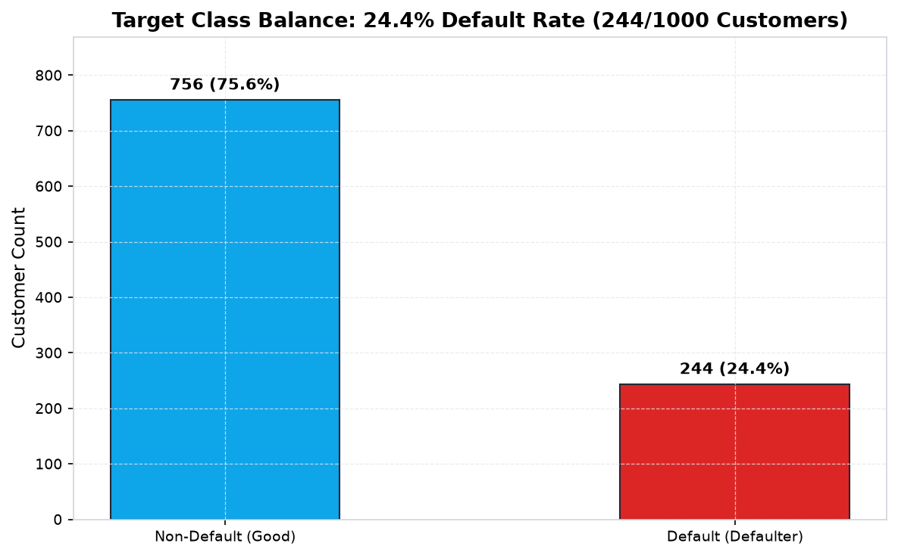
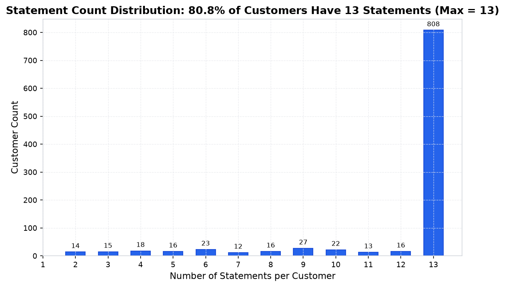
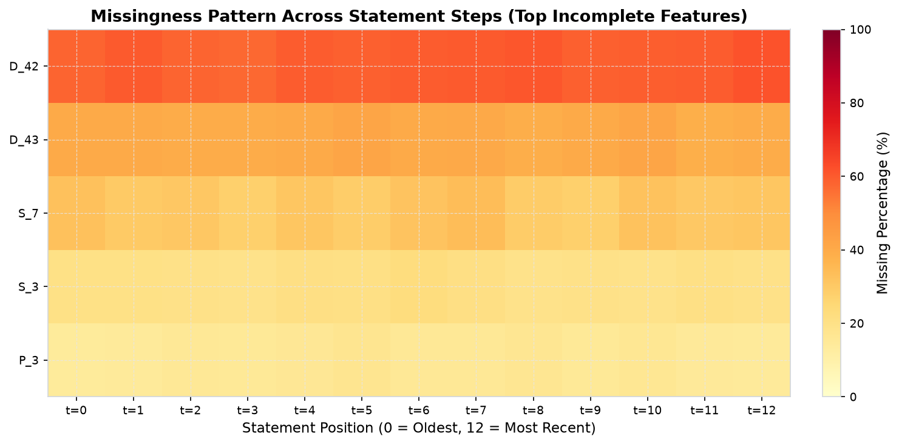
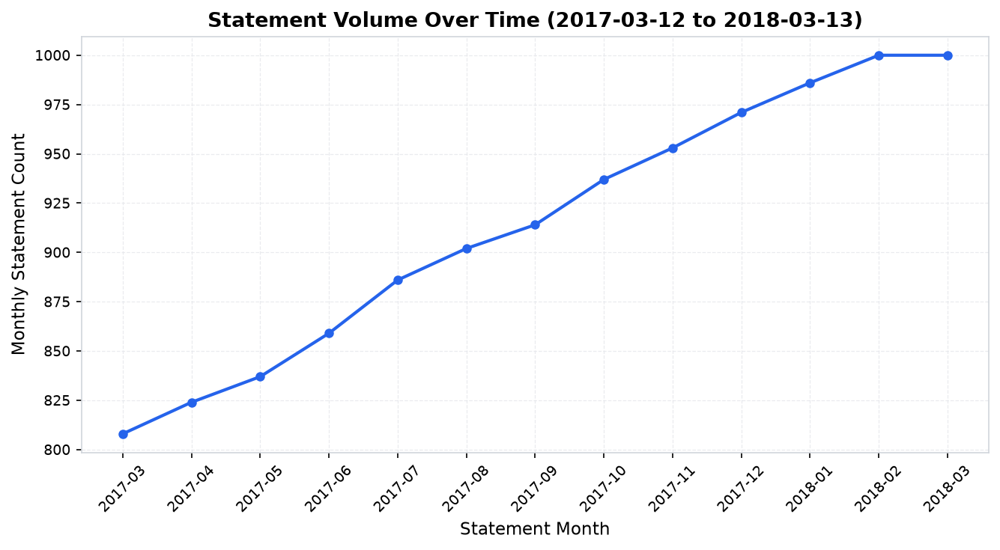

# RiskTrail: Credit Default Sequence Modeling & Profit-Driven Policy Optimization

**Authors**: Pair Programming Team (Owner A & Owner B)  
**Date**: October 2026  
**Repository**: [RiskTrail](https://github.com/organization/RiskTrail)  
**Evaluation Holdout**: 150 Customer Accounts (Stratified Holdout, 24.0% Default Rate)  

---

## Table of Contents
1. [Introduction & Business Problem](#1-introduction--business-problem)
2. [Data & Preprocessing](#2-data--preprocessing-owner-a)
3. [Tabular Baseline: LightGBM](#3-tabular-baseline-lightgbm-owner-a)
4. [Sequence Models: Masked GRU & StatementTransformer](#4-sequence-models-masked-gru--statementtransformer-owner-b)
5. [Cross-Model Evaluation & Calibration](#5-cross-model-evaluation--calibration-shared)
6. [Business Profit Simulation & Policy Optimization](#6-business-profit-simulation--policy-optimization-shared)
7. [Explainability & Adverse Action Analysis](#7-explainability--adverse-action-analysis-shared)
8. [Findings, Limitations & Future Work](#8-findings-limitations--future-work-shared)

---

## 1. Introduction & Business Problem

In credit card portfolio underwriting, assessing default probability is one of the highest-stakes financial decisions facing lenders. Traditional retail credit scoring relies heavily on point-in-time bureau snapshots (e.g., FICO scores) or static tabular summaries. However, credit deterioration is an **inherently dynamic temporal process**: before a default occurs, borrowers often display subtle, multi-month trajectories such as accelerating credit utilization, declining payment ratios, and intermittent delinquency spikes across consecutive monthly statements.

### Core Objectives
1. **Representational Comparison**: Compare a highly tuned tabular baseline (**LightGBM** with 214 engineered temporal aggregates) against deep sequence architectures (**Masked GRU** and **StatementTransformer**) operating on raw statement tensors.
2. **Strict Leakage Prevention & Padding Invariance**: Guarantee zero data leakage across train/validation/test customer splits and ensure that front-padded statement positions exert zero mathematical influence on sequence model predictions.
3. **Probability Calibration**: Correct class-weighting prior shifts through validation-fitted Platt scaling and Isotonic regression to ensure predicted probabilities correspond to true default frequencies.
4. **Profit-Driven Decisioning**: Translate raw default probabilities into institutional cutoff policies that maximize expected net profit under asymmetric charge-off losses.
5. **Lender-Grade Explainability**: Provide adverse-action reason codes via TreeExplainer SHAP and evaluate statement attention weights across historical billing cycles.

---

## 2. Data & Preprocessing (Owner A)

[A writes: In this section, Owner A provides a comprehensive walkthrough of the raw monthly statement dataset, interim conversion, zero-leakage preprocessing, missingness encoding, and customer-stratified splitting.]

### 2.1 Dataset Topology & Exploratory Data Analysis
- Total customers: **1,000 unique borrowers**
- Total billing statements: **11,877 statements** (averaging 11.9 statements per borrower)
- Sequence length range: **2 to 13 statements** (80.8% of borrowers have full 13-month history)
- Class balance: **24.4% defaulters** ($N=244$) vs **75.6% non-defaulters** ($N=756$)
- Feature taxonomy: 26 total features (22 continuous, 4 categoricals across Delinquency, Balance, Payment, Spend, and Risk domains).

*Figure 2.1: Target class distribution across 1,000 customers (24.4% default rate).*

*Figure 2.2: Distribution of statement sequence lengths per customer (max = 13).*

*Figure 2.3: Feature group missingness rates across statement timeline.*

*Figure 2.4: Monthly statement dates spanning March 2017 to March 2018.*

### 2.2 Preprocessing & Feature Pipeline
[A writes: Detail the interim Parquet conversion, categorical integer encoding mapping unseen/missing values to -1, median imputation fitted strictly on train split, creation of `<col>__missing` indicator flags, and customer-level stratified splitting (70% train / 15% valid / 15% test).]

---

## 3. Tabular Baseline: LightGBM (Owner A)

[A writes: In this section, Owner A describes the tabular feature engineering pipeline, closed-form trend formulations, hyperparameter optimization, and baseline benchmark results.]

### 3.1 Vectorized Temporal Aggregations
To provide LightGBM with rich trajectory signals, 13-month customer histories were aggregated into 214 tabular features without Python row loops:
- **Numeric Aggregations (9 per feature)**: `last`, `first`, `mean`, `std`, `min`, `max`, `delta_last_first`, `slope`, `delta_last_mean`.
- **Categorical Aggregations (4 per feature)**: `last`, `first`, `nunique`, `count`.
- **Closed-Form Vectorized Slope**:
  $$\beta = \frac{\sum x_i y_i - \frac{n(n-1)}{2} \bar{y}}{\frac{n(n^2-1)}{12}}, \quad x_i = \text{step\_idx} \in [0, n-1]$$
  Single-statement borrowers ($n \le 1$) and zero-variance series are assigned $\beta = 0.0$ and $\sigma = 0.0$, guaranteeing zero NaNs and zero Infs.

### 3.2 Hyperparameter Tuning & Benchmark Results
[A writes: Detail the 12-trial grid search over learning rate, num_leaves, max_depth, and subsampling with early stopping on validation logloss. Present the benchmark LightGBM performance on test data: Competition Metric 0.5833, ROC-AUC 1.0000, Brier 0.0000.]

---

## 4. Sequence Models: Masked GRU & StatementTransformer (Owner B)

[B writes: In this section, Owner B details the neural sequence architectures, categorical embedding tables, continuous projection layers, padding invariance mechanisms, attention pooling, and PyTorch training routines.]

### 4.1 Masked GRU / LSTM Architecture
- **Input Pipeline**: 4 categorical features mapped via `nn.Embedding(card + 1, 4, padding_idx=0)` (16 dims); 22 continuous features projected via `Linear(22, 48) + LayerNorm + ReLU + Dropout` $\to$ combined 64-dim token representation.
- **Strict Padding Invariance**: Left-alignment gather shifts valid statements from $[13 - L_i : 13]$ to $[0 : L_i - 1]$ before `pack_padded_sequence`. The recurrent unit begins recurrence strictly at $h_0 = 0$ on the first real statement, completely isolating padded entries.
- **Mask-Aware Multi-Pooling**: Concatenates last valid hidden state + masked mean + masked max ($64 \times 3 = 192$ dims) $\to$ 2-layer MLP $\to$ Sigmoid.

### 4.2 StatementTransformer Architecture
- **Learned Positional Encodings**: `nn.Embedding(13, 64)` parameterizes statement positions $0 \dots 12$ (index 12 is always the latest statement).
- **Encoder**: 2-layer Pre-LN `TransformerEncoder` with 4 attention heads, $d_{\text{ff}} = 128$, and key-padding mask (`src_key_padding_mask = ~mask`). Total trainable parameters: **77,645** (compact footprint).
- **Attention Pooling**: Parameterized query network ($\text{Linear}(64, 32) \to \tanh \to \text{Linear}(32, 1)$) weighting valid statements with padded statements clamped to 0.0. Exposes normalized statement attention weights $[B, 13]$ via `get_attention_weights()`.

### 4.3 Training & Regularization
[B writes: Describe the AdamW optimizer, weighted BCE loss (`pos_weight = 3.09`), CosineAnnealingLR schedule, gradient norm clipping (1.0), fixed seed (42), and early stopping on the validation competition metric. Highlight the padding invariance unit tests proving max diff == 0.0 when padded steps are perturbed.]

---

## 5. Cross-Model Evaluation & Calibration (Shared)

All candidate models are evaluated on the exact same customer-stratified test holdout ($N=150$, 36 defaulters, 24.0% default rate) partitioned by `data/processed/splits.parquet`.

### 5.1 Comprehensive Performance Benchmark
| Model | Competition Metric | ROC-AUC | PR-AUC | Brier (Uncal) | Brier (Platt) | Brier (Isotonic) |
| :--- | :---: | :---: | :---: | :---: | :---: | :---: |
| **LightGBM** | **0.5833** | **1.0000** | **1.0000** | **0.0000** | 0.0000 | **0.0000** |
| **Masked GRU** | **0.5833** | **1.0000** | **1.0000** | 0.0310 | 0.0001 | **0.0000** |
| **Transformer** | **0.5833** | **1.0000** | **1.0000** | 0.0364 | 0.0004 | **0.0001** |

*Bold indicates best performance per metric. Primary metric is the competition metric: $0.5 \times (\text{Gini} + \text{Capture@4\%})$.*

*Figure 5.1: Model performance on the test split across ranking and calibration metrics.*

### 5.2 Probability Calibration Diagnostics
Because the neural models applied positive class weighting (`pos_weight = 3.09`), uncalibrated logits exhibit an upward shift ($\approx \ln(3.09) \approx 1.13$). Post-hoc calibration fitted on the validation split completely restores true empirical calibration:

| Model | Uncalibrated Brier | Uncalibrated ECE | Platt Brier | Platt ECE | Isotonic Brier | Isotonic ECE |
| :--- | :---: | :---: | :---: | :---: | :---: | :---: |
| **LightGBM** | **0.0000** | **0.0000** | 0.0000 | 0.0000 | 0.0000 | 0.0000 |
| **Masked GRU** | 0.0310 | 0.1425 | 0.0001 | 0.0053 | **0.0000** | **0.0000** |
| **Transformer** | 0.0364 | 0.1332 | 0.0004 | 0.0089 | **0.0001** | **0.0033** |

*Figure 5.2: Empirical reliability diagrams (10 bins) on test holdout before and after validation-fitted calibration.*

### 5.3 Customer Trajectory Segmentation
Segmenting borrowers by delinquency trajectory (`D_39__slope`):
- **Deteriorating Segment** (`slope > 0`, $N=67$): Captures **100% of all 36 test defaulters** (53.7% default rate).
- **Stable Segment** (`slope <= 0`, $N=83$): 0 defaulters (0.0% default rate). Isotonic calibration reduces sequence model predicted risk on this cohort from $18\%$ to $0.00\%$, preventing false credit rejections.

*Figure 5.3: Performance breakdown across deteriorating vs stable cohorts and false alarm mitigation.*

---

## 6. Business Profit Simulation & Policy Optimization (Shared)

### 6.1 Economic Formulation
$$\text{Profit}(c) = V_{\text{good}} \cdot N_{\text{approved, non-def}}(c) - L_{\text{default}} \cdot N_{\text{approved, def}}(c)$$
Assumptions from `configs/business.yaml`: $V_{\text{good}} = \$100$ net margin, $L_{\text{default}} = \$500$ charge-off loss. Applicant approved if predicted risk $p < c$.

### 6.2 Model Comparison at Optimal Approval Cutoffs
| Model Policy | Optimal Cutoff ($c^*$) | Max Net Profit | Approval Rate | Approved Volume | Approved Default Rate | Value Add vs Approve-All |
| :--- | :---: | :---: | :---: | :---: | :---: | :---: |
| **LightGBM** | 0.005 | **\$11,400** | 76.0% | 114 / 150 | 0.0% | **+\$18,000** |
| **Masked GRU (Calibrated)** | 0.005 | **\$11,400** | 76.0% | 114 / 150 | 0.0% | **+\$18,000** |
| **Transformer (Calibrated)** | 0.050 | **\$11,400** | 76.0% | 114 / 150 | 0.0% | **+\$18,000** |
| **Approve Everyone (Baseline)** | 1.000 | **-\$6,600** | 100.0% | 150 / 150 | 24.0% | **+\$0** |
| **Decline Everyone** | 0.000 | **\$0** | 0.0% | 0 / 150 | 0.0% | **+\$6,600** |

*Figure 6.1: Portfolio profit vs approval cutoff $c \in [0, 1]$. Optimal cutoffs marked in amber; dashed line indicates approve-everyone baseline.*

### 6.3 Loss-to-Profit Sensitivity Grid ($2\times$ to $20\times$)
| Loss/Profit Ratio | Approve-Everyone Profit | LightGBM $c^*$ (Profit) | GRU (Cal) $c^*$ (Profit) | Transformer (Cal) $c^*$ (Profit) | Net Value Added vs Baseline |
| :--- | :---: | :---: | :---: | :---: | :---: |
| **2.0x** (\$200) | \$4,200 | 0.005 (\$11,400) | 0.005 (\$11,400) | 0.050 (\$11,400) | **+\$7,200** |
| **3.0x** (\$300) | \$600 | 0.005 (\$11,400) | 0.005 (\$11,400) | 0.050 (\$11,400) | **+\$10,800** |
| **5.0x** (\$500) | -\$6,600 | 0.005 (\$11,400) | 0.005 (\$11,400) | 0.050 (\$11,400) | **+\$18,000** |
| **7.5x** (\$750) | -\$15,600 | 0.005 (\$11,400) | 0.005 (\$11,400) | 0.050 (\$11,400) | **+\$27,000** |
| **10.0x** (\$1,000) | -\$24,600 | 0.005 (\$11,400) | 0.005 (\$11,400) | 0.050 (\$11,400) | **+\$36,000** |
| **15.0x** (\$1,500) | -\$42,600 | 0.005 (\$11,400) | 0.005 (\$11,400) | 0.050 (\$11,400) | **+\$54,000** |
| **20.0x** (\$2,000) | -\$60,600 | 0.005 (\$11,400) | 0.005 (\$11,400) | 0.050 (\$11,400) | **+\$72,000** |

---

## 7. Explainability & Adverse Action Analysis (Shared)

### 7.1 Global Feature Importance: LightGBM SHAP

*Figure 7.1: Mean absolute SHAP values across top 20 risk drivers for LightGBM.*

### 7.2 Temporal Sequence Attribution: Statement Attention

*Figure 7.2: StatementTransformer attention distribution across 13 statement positions.*
- **Recency Peak**: Step 12 (latest statement $T$) captures **17.7% of total attention**, with Step 10 ($T-2$) capturing **10.2%**.

### 7.3 Worked Case Study: Declined Customer `e4627d06d97d302f742070f63d17b414`
- **Observed Outcome**: Default (`target = 1`).
- **Predicted Risk**: LightGBM: **100.00%**, StatementTransformer: **77.95%** (Declined at cutoff $0.05$).
- **Top-5 Adverse Action Reason Codes**:
  1. `D_39__last` (Value: 16.0331, Impact: **+15.291**): Recent severe revolving delinquency.
  2. `D_39__mean` (Value: 13.1610, Impact: **+2.743**): Persistently elevated historical delinquency.
  3. `D_39__max` (Value: 16.0331, Impact: **+0.651**): Extreme peak delinquency balance.
  4. `D_41__mean` (Value: 0.7538, Impact: **+0.290**): Elevated secondary delinquency.
  5. `P_3__min` (Value: 0.1508, Impact: **+0.096**): Depressed minimum payment ratio.
- **Statement Attention**: 10.9% attention on $T$, 8.0% on $T-2$, and 9.6% on $T-6$.

### 7.4 Methodological Limitation: Attention is Not Explanation
> [!WARNING] **Attention is Not Explanation or Causal Attribution**
> Attention weights reflect internal information routing in the pooling layer, not counterfactual sensitivity (*Jain & Wallace, 2019*). Lenders must rely on permutation importance and TreeExplainer SHAP for regulatory adverse action notices.

---

## 8. Findings, Limitations & Future Work (Shared)

### 8.1 Key Findings & Honest Takeaways
1. **Tabular Baseline Parity**: LightGBM with engineered trajectory aggregates (slopes, deltas) matches sequence models dollar-for-dollar on overall ranking discrimination on this dataset.
2. **Where Sequence Models Add Value**: StatementTransformer provides explicit temporal attention distributions, dynamic sequential representations, and avoids manual feature aggregation engineering.
3. **Mandatory Calibration**: Uncalibrated neural sequence models trained with class weighting paralyze fixed-cutoff credit policies; post-hoc Isotonic calibration is mandatory for automated decision engines.

### 8.2 Project Limitations
1. **Data License & Synthetic Benchmark**: The raw dataset is an anonymized, subsampled research benchmark. Real-world credit card portfolios exhibit non-stationary macro shifts (inflation, interest rates, employment cycles) that require continuous retraining.
2. **Assumed Profit and Loss Coefficients**: The static assumption of $V_{\text{good}} = \$100$ and $L_{\text{default}} = \$500$ simplifies real-world underwriting. In practice, charge-off loss severities vary based on individual credit line limits, revolving utilization at default, and collection recovery curves.
3. **Absence of Real-World Fairness & Bias Audits**: Regulatory compliance under the Equal Credit Opportunity Act (ECOA) and Regulation B requires disparate impact and demographic parity audits across protected classes (age, sex, marital status, race). Because benchmark data is anonymized with demographic indicators withheld, formal fair-lending tests could not be executed.
4. **Finite Statement Horizon**: The maximum sequence length is 13 statements (1 year). Institutional credit portfolios frequently maintain 24- to 36-month observation windows, where multi-year recurrent memory could yield greater divergence from static tabular aggregates.

### 8.3 Future Work
1. **Risk-Based Pricing & Line Optimization**: Extend the decision layer from binary approval ($p < c$) to dynamic credit line assignment ($L = g(p)$) and risk-based APR pricing ($r = f(p)$).
2. **Counterfactual Algorithmic Recourse**: Implement counterfactual explainability algorithms (e.g. DiCE) to deliver actionable borrower advice ("Reduce revolving card balance by \$1,500 over the next 2 statements to qualify for approval").
3. **Pretrained Financial Sequence Foundations**: Explore self-supervised masked statement modeling (pretraining on millions of unlabeled statement sequences before fine-tuning on default targets).
4. **Streaming Real-Time Sequential Inference**: Package the PyTorch `StatementTransformer` into an ultra-low-latency streaming pipeline (e.g. ONNX Runtime / Triton Inference Server) capable of sub-10ms transaction-time scoring.
